# ALP-ttbar Toy MC v1.7: Post-registration Results for a Three-Dimensional Two-Hypothesis Vertex Fit (Adding the r–z Opening Angle) of Displaced Light ALP → e⁺e⁻

[](https://doi.org/10.5281/zenodo.24011489)

A small, numpy-only toy study motivated by the displaced-dielectron extension [[1]](#references) of the
top-associated long-lived ALP strategy [[2]](#references). Alimena et al. [1] extended the search for long-lived ALPs
produced with a top-quark pair, proposed for displaced dimuons by Rygaard et al. [2], to a → e⁺e⁻, reaching ALP masses
below the dimuon threshold. Their projections are at generator level and do not include detector-level displaced-electron
reconstruction or instrumental backgrounds. This series examines some of those effects at toy level. The physical effects
themselves (bremsstrahlung, multiple scattering, Gaussian-sum-filter electron fits, conversion reconstruction) are well
known [3–9]; the aim is to quantify how they affect the conversion veto in this particular search.

Topics by version:

1. **Magnetic-field separation** of highly collimated e⁺e⁻ pairs (Ref. [1] uses straight lines) *(v1.0)*.
2. **Photon conversions** (γ → e⁺e⁻ in tracker material) as a background for the lightest ALPs *(v1.0)*.
3. **Vertex resolution** of nearly collinear pairs and how strongly the conversion veto depends on it *(v1.1)*.
4. **Hit-pattern consistency** as a handle against resolution tails, under a public preregistration *(v1.2)*.
5. **Vertex resolution and tails from a mini tracking simulation**, under a public preregistration *(v1.3)*.
6. **Bremsstrahlung-aware vertex fits**: an inner-hit fit and a Gaussian brems-noise fit, under a public preregistration *(v1.4)*.
7. **Two-hypothesis vertex fit** (conversion vs. ALP opening angle), under a public preregistration *(v1.5)*.
8. **Magnetic-field and material-budget scan** of the two-hypothesis selection, under a public preregistration *(v1.6)*.
9. **Three-dimensional two-hypothesis vertex fit** (adding the r–z opening angle; stereo and all-pixel variants), under a public preregistration *(new in v1.7)*.

> **Disclaimer.** This is an independent personal project. It is not affiliated with the authors of Refs. [1, 2] or with
> the CMS, LHCb or ALICE Collaborations or the FCC study. ALP and photon kinematics are parametrised and detector numbers are assumed, so only qualitative
> trends and ratios are meaningful; no claim is made about the performance of a real detector. See the PDF for all
> assumptions and limitations.

## New in v1.7: preregistered three-dimensional vertex fit

Preregistration (frozen and public before any v1.7 result; an amendment adding V-allpixel and P7 was committed before any
computation): https://doi.org/10.5281/zenodo.23995668 ·
https://github.com/wspaik5/ALP_ttbar_Toy_MC_v1.7_Preregistration_3D_Vertex_Fit (SHA-256 of the README `b538ea63…1ec3beb`).

v1.5 and v1.6 used only the transverse view, where a free vertex absorbs a small ALP opening and bremsstrahlung fakes
openings. In the r–z view the tracks are straight in the transverse path length, a vertex shift cannot absorb a polar
opening, bremsstrahlung barely changes the polar angle, and conversions have Δcotθ ≈ 0. Using the r–z opening against
conversions (Δcotθ) and 3D vertex fitting are standard [21, 22]; the claim is limited to this search. v1.7 adds z hits
(`lz.py`; pixel layers at 25 µm by default, a stereo-strip variant and an all-pixel variant) and an r–z two-hypothesis test
on the unchanged transverse fit of v1.6 config R (identity 100.000%). Δχ²_3D = Δχ²_T + Δχ²_L.

**Limit degradation from conversions** (cτ = 1 mm, 3.8 T, subsample):

| selection | 17 MeV | 50 MeV | 100 MeV | 200 MeV | no mass window 17 / 200 |
|---|---|---|---|---|---|
| Δχ²_T only (= v1.6 config R) | 127× | 68× | 28× | 8.2× | 137× / 130× |
| Δχ²_L only (pixel z) | 122× | 55× | 22× | 5.9× | 133× / 103× |
| **Δχ²_3D, pixel z (default)** | **127×** | **64×** | **24×** | **6.1×** | 137× / 119× |
| Δχ²_3D, V-stereo | 127× | 61× | 21× | 4.5× | 137× / 99× |
| Δχ²_3D, V-allpixel (z at every layer) | 117× | 39× | 13× | 3.9× | 133× / 78× |

**Mechanism:** with pixel z, 0.84% of conversions with r–z information have Δχ²_L > 9 (transverse view: 9.6%), against
15.5% / 54.8% / 76.3% / 86.5% of ALP pairs at 17 / 50 / 100 / 200 MeV; but only 14–34% of pairs have r–z information.
With z at every layer all pairs have it, and the conversion fraction rises to 7.4%.

| prediction (frozen) | outcome | verdict |
|---|---|---|
| P1: 17 MeV in 100–127× | 127.3× (no gain; equal to the baseline quoted as 127×) | confirmed (at the upper edge) |
| P2: 200 MeV in 3–7× | 6.1× | confirmed |
| P3: 100 MeV in 12–25× | 24.2× | confirmed |
| P4: conversions with r–z info, Δχ²_L > 9 ≤ 1% | 0.84% | confirmed |
| P5: ALP with r–z info, Δχ²_L > 9: 5–25% (17 MeV), ≥ 60% (200 MeV) | 15.5%, 86.5% | confirmed |
| P6: V-stereo improves 200 MeV by ≥ 10% | 6.1× → 4.5× (26%) | confirmed |
| P7: V-allpixel: ≥ 95% with info; 17 MeV ≥ 25% lower; still > 20× | 100%; 7.8% lower; 117× | **refuted** (gain part) |

- **The r–z view works where the transverse view failed.** A polar opening enters the hits at first order and is not faked
  by bremsstrahlung in the pixel volume, so from 50 MeV on most ALP pairs with r–z information are separated.
- **Why 17 MeV is not recovered.** Only 15% of 17 MeV pairs give r–z information with pixel z. With z at every layer, the
  electrons that have lost energy to bremsstrahlung scatter more than the covariance assumes, which fakes polar openings
  in 7.4% of conversions, while the 17 MeV opening (median 0.42 mrad) is comparable to the polar scattering per layer.
  Within this toy, bremsstrahlung limits the lightest ALPs in the r–z view too, now through the momentum that sets the
  scattering.
- **Validation and reference distributions.** Z1–Z3 passed. On the null sample Δχ²_L had median 0.428 and 5.0% above 3.84
  (χ²₁: 0.455, 5%), and Δχ²_3D median 0.820 and 8.6% (½χ²₁ + ½χ²₂: 0.867, 9.8%): the references fixed in advance, as
  proposed in v1.6, described the null distributions.

**Deviation (sanity gate).** With each r–z hypothesis using the path lengths from its own transverse fit (as preregistered),
Δχ²_L was negative for 2.0% / 2.4% / 12.7% of conversions (default / stereo / allpixel), against the frozen limit of 0.1%.
For these pairs the H_ALP transverse vertex lay a median 31 mm from the H_conv vertex (6 mm for all pairs): it slides along
the nearly parallel tracks (the flat direction diagnosed in v1.5), so the two r–z fits were no longer nested. Fix, chosen
on this diagnosis before any degradation was computed: both r–z hypotheses use s from the H_conv transverse fit; the gate
then passed (0.000% negative everywhere). The preregistered-definition values are stored in the outputs. Other minor
deviations are listed in the PDF.

## Future directions

Planned next steps, each under a public preregistration:

1. **Gaussian-sum filter (ACTS)** [5, 6] with 3D propagation, which follows the momentum lost to bremsstrahlung and thereby
   the scattering that now fakes polar openings.
2. **All-pixel tracker with reduced material**, combining V-allpixel with the v1.6 material scan (the most effective handle
   there, which also reduces the scattering identified here), and a first layer closer to the beam. This is the combination
   pursued by next-generation tracker concepts: monolithic all-pixel layers with a very low material budget in ALICE 3
   [17] and the FCC-ee detectors at about 2 T [15, 16]. Taken together, v1.6 and v1.7 suggest, within this toy, that for
   the lightest ALPs full z coverage alone is not enough (V-allpixel: 7.8% gain at 17 MeV) and material reduction alone
   leaves a large loss (v1.6: 35× at a quarter of the material), so a toy configuration of that kind is the natural next
   test. No statement about the performance of these detectors is made.
3. **Joint 3D vertex fit** instead of the sequential fit.
4. **Dimuon control study** (no bremsstrahlung), isolating the electron-specific part of these limits.
5. **μ⁺μ⁻ above 200 MeV and other long-lived-particle signatures**, e.g. ALPs from B-meson decays [18].
6. **Calibrated test statistics** as applied here: regularity checked in advance; boundary mixtures (Chernoff [11],
   Self and Liang [12]) or pseudo-experiments, as standard in collider searches [20].

## v1.6: preregistered field and material scan

Preregistration (frozen and public before any v1.6 result was computed):
https://doi.org/10.5281/zenodo.23942338 ·
https://github.com/wspaik5/ALP_ttbar_Toy_MC_v1.6_Preregistration_Field_Material_Scan (SHA-256 of the README
`a9e4b64b…8835c4`).

v1.5 found no gain from the two-hypothesis vertex fit at 17–50 MeV in a 3.8 T field. The residual mismatch that the fit
can see scales as 1/B, while conversions and bremsstrahlung scale with the material budget. v1.6 repeats the v1.5 analysis
in eight configurations of the field B and a material scale factor f, with the momentum resolution of the pair mass
scaled as 1/B and the scattering term as √f (subsample: 100,000 conversion and 60,000 signal pairs per mass). Config R
reproduces v1.5 for 100.000% of pairs. Field and material optimisation, reduced-field running [14] and field-based
conversion rejection (φ_V) [19] are established ideas; the claim is limited to this search.

**Limit degradation from conversions** (cτ = 1 mm, v1.5 selection):

| config | B, f | 17 MeV | 50 MeV | 100 MeV | 200 MeV | no mass window 17 / 200 | conversion vertex core |
|---|---|---|---|---|---|---|---|
| R | 3.8 T, 1 | 127× | 68× | 28× | 8.2× | 137× / 130× | 7.9 mm |
| B2 | 2.0 T, 1 | 155× | 80× | 27× | 7.4× | 165× / 125× | 10.3 mm |
| B1 | 1.0 T, 1 | 184× | 85× | 21× | **6.4×** | 200× / 102× | 14.6 mm |
| B05 | 0.5 T, 1 | 184× | 66× | 20× | 7.4× | 200× / 71× | 22.9 mm |
| B02 | 0.2 T, 1 | 188× | 58× | 23× | 10.9× | 200× / **52×** | 47.9 mm |
| M05 | 3.8 T, 0.5 | **65×** | 36× | 16× | 5.7× | 70× / 70× | 4.9 mm |
| M025 | 3.8 T, 0.25 | **35×** | 20× | 8.8× | 2.1× | 37× / 36× | 3.7 mm |
| C | 2.0 T, 0.5 | 87× | 48× | 15× | 3.9× | 92× / 68× | 6.9 mm |

| prediction (frozen) | outcome | verdict |
|---|---|---|
| P1: M05, 17 MeV in 40–90× | 65× | confirmed |
| P2: M025, 17 MeV in 20–63× | 35× | confirmed |
| P3: B02, 17 MeV worse than R | 188× vs 127× | confirmed |
| P4: B02, 200 MeV better than R | 10.9× vs 8.2× | **refuted** |
| P5: 17 MeV ALP Δχ² > 9 rises R → B02 to ≥ 30% (conversions lower) | 9.2% → 5.3% (conversions 9.6% → 1.4%) | **refuted** |
| P6: curvature resolution ≥ 10× worse at B02 | 49.7% vs 18.3% (2.7×) | **refuted** |
| P7: C at 17 MeV between M05 and B2 | 87× | confirmed |

- **Material is the effective handle.** The 17 MeV loss falls roughly in proportion to f (127× → 65× → 35×), faster than
  the √f expected from the conversion yield alone, because bremsstrahlung and fake openings fall too.
- **Lowering the field does not help the lightest ALPs.** Conversion vertices are located by where two oppositely bent
  tracks become tangent; with little bending the vertex resolution grows to ≈ 48 mm and the material veto is abandoned
  (B ≤ 1 T at 17 MeV).
- **Δχ² improves at low field, but the mass resolution pays for it.** Without mass window the 200 MeV loss falls from 130×
  to 52× at 0.2 T; with it, the 1/B momentum resolution offsets the gain and the optimum is near 1 T.
- **Electron curvature is already bremsstrahlung-limited at 3.8 T** (18%), so the field matters less than expected for it.
- **Wilks' theorem, revisited.** In v1.5 the preregistered χ²₁ null reference (Wilks' theorem) failed, because with a
  free vertex the opening angle is identified only at second order and the null lies on a parameter boundary (see the
  v1.5 section below). v1.6 used the boundary mixture ½χ²₀ + ½χ²₁ as the reference from the start, and validation Y1
  passed at 0.2 T and 2.0 T (fraction at zero 0.45 / 0.51, median of the non-zero part 0.51 / 0.46), confirming at two
  further fields that the mixture, not χ²₁, is the right null distribution for this test. The full v1.5 record (what was
  preregistered, what was observed, why Wilks' theorem does not apply, Table and Figure 9) is reproduced unchanged in the
  v1.5 section below and in Appendix A of the v1.6 PDF.
- Validation Y1–Y3 passed. **Deviations:** an interim
  analysis of configs R, B02 and M05 was run while the other fits were still running (nothing changed afterwards);
  B and f are read from environment variables (defaults reproduce v1.5).

## v1.5: preregistered two-hypothesis vertex fit

Preregistration (frozen and public before any v1.5 result was computed):
https://doi.org/10.5281/zenodo.23905511 ·
https://github.com/wspaik5/ALP_ttbar_Toy_MC_v1.5_Preregistration_Two_Hypothesis_Vertex_Fit (SHA-256 of the README
`59e18a40…a1524c`).

v1.4 showed that a well-calibrated, brems-aware fit still leaves a large loss from conversions, partly because ALP pairs
are fitted under the conversion hypothesis (tracks parallel at the vertex). v1.5 keeps **the identical simulated hits**
and fits every pair twice (`fit2h.py`):

- **H_conv** = v1.4 fit (b) (reproduces the v1.4 vertex radius for 100.000% of pairs in all samples);
- **H_ALP**: same hits, covariance and track model, both track directions free, seeded from H_conv.

Pairs with Δχ² = χ²_conv − χ²_ALP ≥ k skip the material veto; k is scanned together with the veto width and the mass
window, and k = none reproduces v1.4 (b) exactly.

**Limit degradation from conversions** (cτ = 1 mm):

| m_a | v1.4 (b) | **v1.5 two-hypothesis** | best k | (a)+(b), secondary | no mass window: v1.4 (b) → v1.5 | no-brems bound |
|---|---|---|---|---|---|---|
| 17 MeV | 126× | **126×** | none | 111× | 136× → 136× | 1.9× |
| 50 MeV | 68× | **68×** | none | 60× | 141× → 141× | 2.0× |
| 100 MeV | 32× | **28×** | 4 | 28× | 143× → 143× | 1.9× |
| 200 MeV | 14× | **9.1×** | 9 | 12× | 139× → 130× | 1.8× |

**Fraction with Δχ² > 9:** conversions (r < 800 mm) 9.6%; ALP 17 / 50 / 100 / 200 MeV: 9.2% / 10.3% / 16.8% / 35.6%.

| prediction (frozen) | outcome | verdict |
|---|---|---|
| P1: 17 MeV ≥ 100× | 126× | confirmed |
| P2: 100 MeV in 5–20× | 28× | **refuted** (worse) |
| P3: 200 MeV in 2–7× | 9.1× | **refuted** (worse) |
| P4: 50 MeV ≥ 34× | 68× | confirmed |
| P5: Δχ² > 9 for conversions 5–25%, ALP 17 MeV ≤ 20%, ALP 200 MeV ≥ 60% | 9.6%, 9.2%, 35.6% | **refuted** (200 MeV part) |
| P6: (a)+(b) 17 MeV in 101–151× | 111× | confirmed |

- **Small openings are absorbed, not lost.** At 17–50 MeV a free vertex reproduces an ALP pair as a conversion displaced
  by a few mm; the residual mismatch (≈ 2 µm at 1 mrad) is below the hit resolution, so no gain.
- **Bremsstrahlung fakes openings.** About 10% of conversions have Δχ² > 9, as many as 17 MeV ALP pairs.
- **The modest gain at 100–200 MeV needs the mass window**; without it (V-nomass) it nearly vanishes. Because mass and
  Δχ² measure the same opening angle in a real detector, the with-mass result is likely optimistic.
- Within this toy, the remaining loss is set by bremsstrahlung, not by the vertex hypothesis.

### v1.5 validation X1 failed: why Wilks' theorem does not apply here

Wilks' theorem [10] says that a likelihood-ratio statistic follows χ²₁ for one extra parameter, but only under
regularity conditions: the tested value must lie inside the parameter space and the parameter must change the
prediction at first order (non-singular information matrix). Both conditions fail for the opening angle when the
vertex is free, as shown below.


The preregistered null test X1 (zero opening, no brems) expected Δχ² to follow χ²₁ (Wilks [10]): median 0.30–0.65 and
3–8% above 3.84. The result was a median of 0.000 and 2.15% above 3.84, so **X1 failed**. Nothing was changed. The
post-hoc diagnosis (`x1_boundary.py`, Figure 9; it does not affect any number above):

1. **Not a minimiser problem.** Fixing the opening at 0.1–5 mrad and re-fitting all other parameters never gives a lower
   χ² than the conversion fit (beyond the minimiser tolerance).
2. **Mechanism.** The vertex shift absorbs Δφ at first order, so the hits respond only to ψ ∝ Δφ² ≥ 0. The χ² rise grows
   as Δφ⁴ instead of Δφ² (measured log–log slope 4.3): the information matrix is singular in Δφ [13]. The null ψ = 0 lies
   on the parameter boundary, where the likelihood ratio follows **½χ²₀ + ½χ²₁** [11, 12].
3. **Quantitative check:**

   | quantity | X1 sample | ½χ²₀ + ½χ²₁ | χ²₁ (preregistered) |
   |---|---|---|---|
   | fraction with Δχ² = 0 | 51.3% | 50% | 0% |
   | median of the non-zero part | 0.457 | 0.455 | – |
   | fraction > 2.71 | 4.88% | 5.0% | 10% |
   | fraction > 3.84 | 2.15% | 2.5% | 5% |

4. **Consequences.** The test remains usable with the mixture as reference (validation X2 with a known opening passed:
   median Δχ² 0.00 / 0.04 / 2.1 / 23 at 0 / 2 / 5 / 10 mrad). The main result is unaffected because k was scanned. The
   17 MeV result is a resolution and bremsstrahlung limit of this toy detector, not a statistical impossibility.

**Other deviations** (details in the PDF): (1) before the main run, H_conv was tested on 2000 conversion pairs to verify the
identity with v1.4 (b); this also printed summary Δχ² values for those pairs, and nothing was changed after it;
(2) an optional `return_state` argument was added to `minitrack.vertex_fit` (default unchanged, identity gate 100.000%).

## Figures

**Figure 11 (new in v1.7).** (a) Δχ²_L survival fractions for conversions and ALP pairs with r–z information and the χ²₁
reference; (b) degradation versus mass for the transverse-only, r–z-only and 3D selections and the two variants, with the
preregistered ranges; (c) the same without mass window.

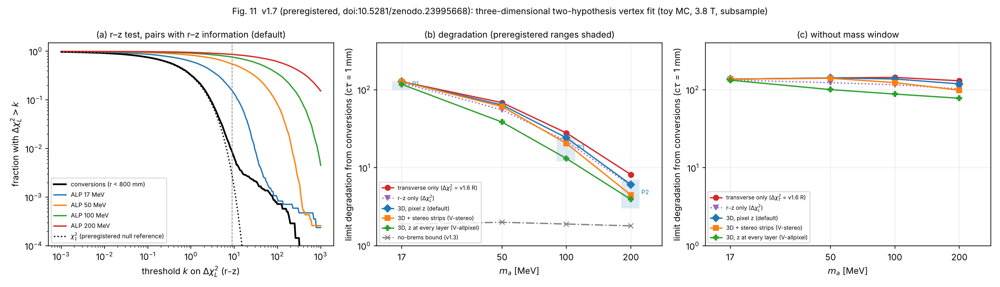


**Figure 10 (v1.6).** (a) Degradation versus field at f = 1 (dotted: without mass window); (b) degradation versus
material at 3.8 T with the preregistered ranges and the combined point; (c) Δχ² > 9 fractions and curvature resolution
versus field.

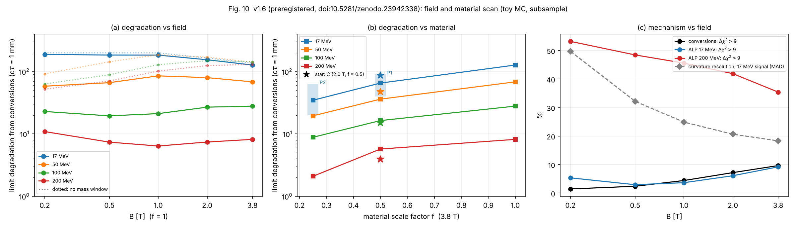


**Figure 8 (v1.5).** (a) Fraction of pairs with Δχ² > k for conversions and ALP pairs; (b) limit degradation
with the preregistered ranges; (c) the V-nomass check.

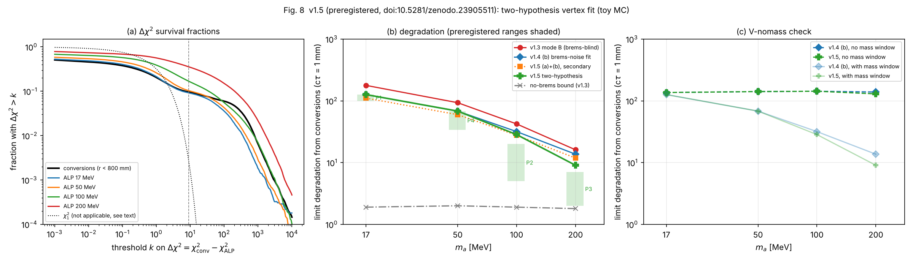

**Figure 9 (v1.5, post-hoc).** (a) Null distribution of Δχ² on the X1 sample compared with χ²₁ and the boundary
mixture ½χ²₀ + ½χ²₁; (b) χ² rise when the opening is fixed and all other parameters are re-fitted, with Δφ² and Δφ⁴
references.

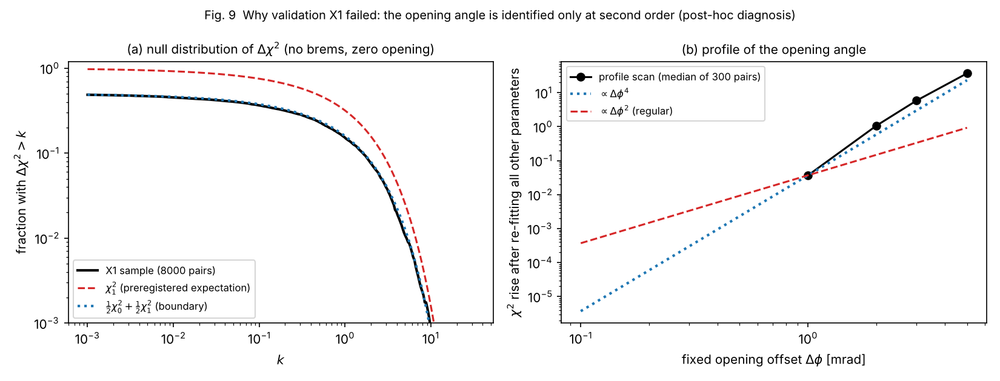

Figures 1–7 from earlier versions (unchanged, reproduced by the same code):


**Figure 7 (v1.4).** (a) Radial residual and (b) pulls of fitted conversion vertices for the v1.3 brems-blind fit,
fit (a) and fit (b); (c) limit degradation with the preregistered ranges and the no-brems bound.

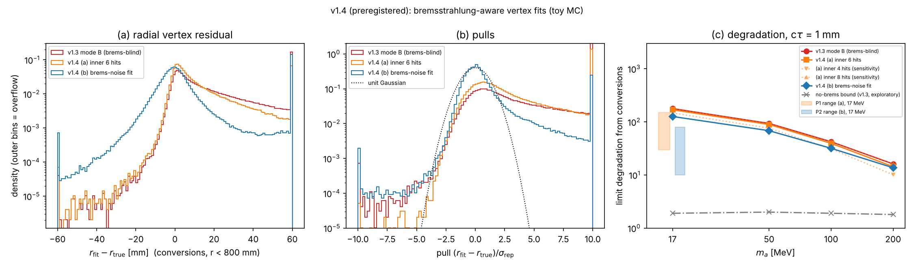

**Figure 1 (v1.0).** Decay geometry, boost and opening angle, and toy pre-selection efficiency compared with Table 3 of Ref. [1] (after one global normalisation factor).

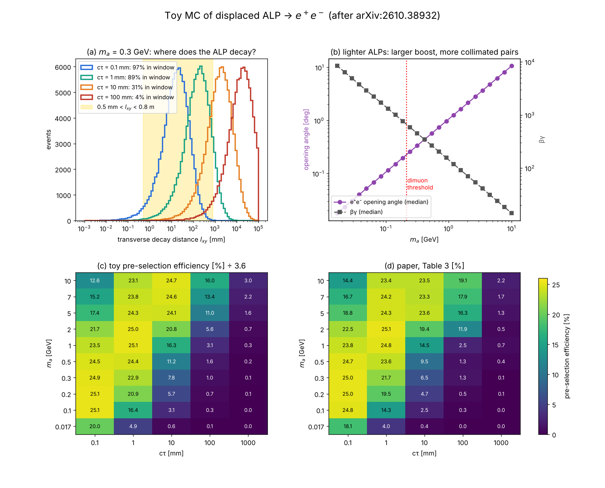

**Figure 2 (v1.0).** Hit separation of e⁺e⁻ pairs in the barrel layers with straight lines vs. a 3.8 T field, and the resulting fraction of resolvable pairs.

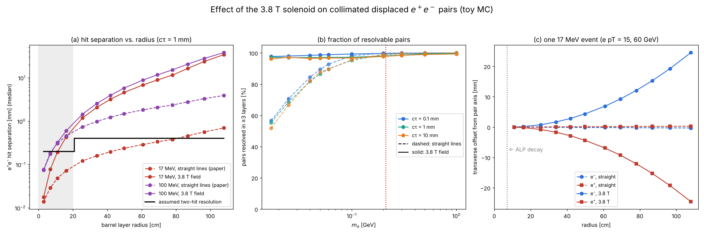

**Figure 3 (v1.0).** Photon conversions: measured vertex radius, measured mass, and degradation of the expected limit for successive selections.

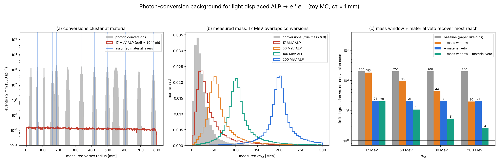

**Figure 4 (v1.1).** Per-pair vertex resolution vs. mass, the 17 MeV veto trade-off, and the limit degradation for four resolution scenarios.

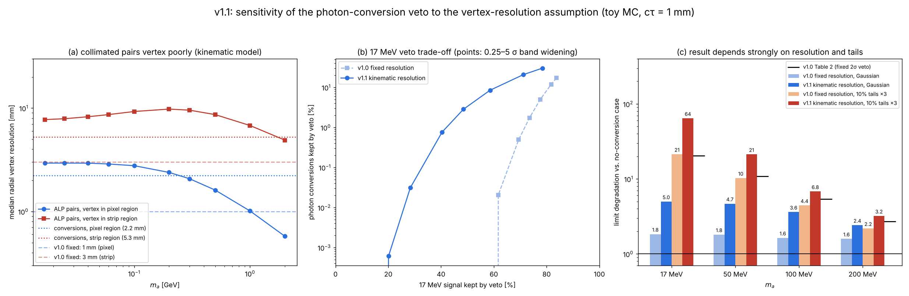

**Figure 5 (v1.2).** Hit-pattern requirement: limit degradation with and without it, preregistered prediction vs. outcome, and the lifetime scan.

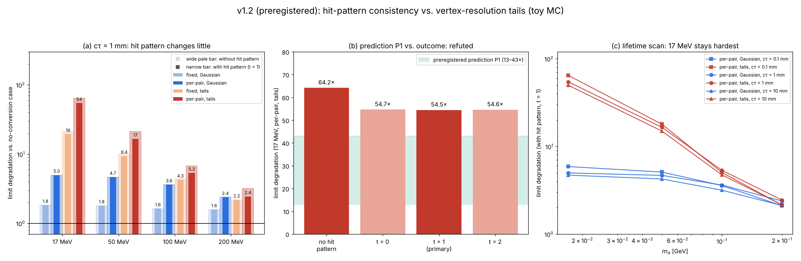

**Figure 6 (v1.3).** Mini tracking simulation: radial residual of fitted conversion vertices, pulls, and limit degradation compared with v1.1 and the preregistered ranges.

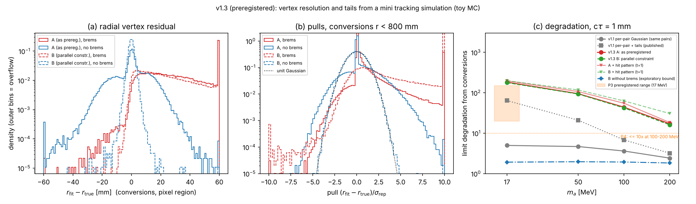

## Files


| file | content |
|---|---|
| `alp_toy.py`, `mag.py`, `bkg.py`, `vtx.py` | v1.0–v1.1: kinematics, helices and layers, conversions and selection, analytic vertex resolution |
| `hitpattern.py`, `run_v12.py` | v1.2: hit-pattern requirement and preregistered analysis |
| `minitrack.py`, `validate_v13.py`, `run_v13.py`, `explore_nobrems_v13.py` | v1.3: mini tracking simulation and vertex fit (v1.4 hooks, v1.5 `return_state`, v1.7 `return_path`; defaults unchanged) |
| `brfit.py`, `validate_v14.py`, `run_v14.py` | v1.4: inner-hit fit (a), brems-noise fit (b), validation, analysis |
| `fit2h.py` | *(v1.5)* two-hypothesis fit (H_conv, H_ALP, Δχ²) and the (a)+(b) combination |
| `validate_v15.py` | *(v1.5)* validation X1, X2 |
| `run_v15.py` | *(v1.5)* `fit SAMPLE 2h/ab` → `analyze` (sanity gate, `scan_v15`, V-nomass, P1–P6) |
| `x1_boundary.py`, `diag_x1_profile.py` | *(v1.5, post-hoc)* X1 diagnosis: boundary mixture and profile scan (Figure 9) |
| `plot_*.py` | Figures 1–8, 10, 11 |
| `validation_v15.txt`, `run_v15_fit_log.txt`, `run_v15_output.txt`, `x1_boundary.txt` | printed v1.5 numbers |
| `run_v16.py`, `validate_v16.py`, `runq.sh` | *(v1.6)* field/material configurations (env `V16_B`, `V16_F`), fits, sanity gate, scans, P1–P7; validation Y1–Y3 |
| `plot_fig10.py` | *(v1.6)* Figure 10 |
| `validation_v16.txt`, `run_v16_fit_log.txt`, `run_v16_output.txt` | printed v1.6 numbers |
| `lz.py` | *(v1.7)* longitudinal (r–z) simulation along the transverse path and r–z two-hypothesis fit; geometries default / stereo / allpixel |
| `run_v17.py`, `validate_v17.py`, `plot_fig11.py` | *(v1.7)* fits, sanity gate, scans, P1–P7; validation Z1–Z3; Figure 11 |
| `validation_v17.txt`, `run_v17_fit_log.txt`, `run_v17_output.txt` | printed v1.7 numbers |
| `ALP_ttbar_Displaced_Dielectron_Toy_MC_Summary_v1.7_2026-11-07.pdf` | v1.7 report |

## Reproduce

```bash
pip install -r requirements.txt
./run_all.sh
```

Fixed random seeds are used. Figures 1–5 take about 5 minutes, the v1.3 part about 2.5 hours, the v1.4 fits about
3.5 hours, the v1.5 fits about 6 hours, the v1.6 scan about 6 hours and the v1.7 fits about 40 minutes on one core.

## Known limitations

All v1.0–v1.6 limitations apply (barrel only, idealised layers, no pattern recognition, toy material map, crude counting
rule, selection optimised on the same samples, truth used for the material list and the scattering momentum,
single-Gaussian bremsstrahlung model). The v1.7 3D fit is sequential, not joint; one z resolution per layer type;
V-allpixel changes only the z coverage, not the material; the pair mass is generated independently of the hits.

## Citation

> Paik, W. S. (2026). *ALP-ttbar Toy MC v1.7: Post-registration Results for a Three-Dimensional Two-Hypothesis Vertex Fit
> (Adding the r–z Opening Angle) of Displaced Light ALP → e⁺e⁻* (v1.7) [Preprint]. Zenodo. https://doi.org/10.5281/zenodo.24011489

Preregistration: https://doi.org/10.5281/zenodo.23995668 · Previous versions: v1.6 https://doi.org/10.5281/zenodo.23952888 ·
v1.5 https://doi.org/10.5281/zenodo.23924862 · v1.4 https://doi.org/10.5281/zenodo.23880375 ·
v1.3 https://doi.org/10.5281/zenodo.23862775 · v1.2 https://doi.org/10.5281/zenodo.23847880 ·
v1.1 https://doi.org/10.5281/zenodo.23833475 · v1.0 https://doi.org/10.5281/zenodo.23825276

## Version history

- **v1.7** (2026-11-07): preregistered 3D two-hypothesis vertex fit (Figure 11); P1–P6 confirmed, P7 refuted; the r–z view
  helps at 50–200 MeV but not at 17 MeV; preregistered null references confirmed; one sanity-gate fix.
- **v1.6** (2026-11-05): preregistered field and material scan (Figure 10).
- **v1.5** (2026-11-04): preregistered two-hypothesis vertex fit (Figures 8, 9).
- **v1.4** (2026-11-02): preregistered brems-aware vertex fits (Figure 7).
- **v1.3** (2026-11-01): preregistered mini tracking simulation (Figure 6).
- **v1.2** (2026-11-01): preregistered hit-pattern consistency test and lifetime scan (Figure 5).
- **v1.1** (2026-10-31): per-pair vertex resolution, veto-width optimisation and tail test (Figure 4).
- **v1.0** (2026-10-31): Figures 1–3.

## References


1. J. Alimena, F. Blekman, C. Cazzaniga, X. Cid Vidal, J. Niedziela, L. Rygaard, R. Soto Rey, *Hunting for Long-Lived ALPs in Top Events via Displaced Dielectron Pairs at the LHC*, [arXiv:2610.38932](https://arxiv.org/abs/2610.38932).
2. L. Rygaard, J. Niedziela, R. Schäfer, S. Bruggisser, J. Alimena, S. Westhoff, F. Blekman, *Top Secrets: long-lived ALPs in top production*, JHEP 10 (2023) 138, [arXiv:2306.08686](https://arxiv.org/abs/2306.08686).
3. H. Bethe, W. Heitler, *On the stopping of fast particles and on the creation of positive electrons*, Proc. R. Soc. Lond. A 146 (1934) 83.
4. V. L. Highland, *Some practical remarks on multiple scattering*, Nucl. Instrum. Meth. 129 (1975) 497; G. R. Lynch, O. I. Dahl, *Approximations to multiple Coulomb scattering*, Nucl. Instrum. Meth. B 58 (1991) 6.
5. R. Frühwirth, *Track fitting with non-Gaussian noise*, Comput. Phys. Commun. 100 (1997) 1.
6. W. Adam, R. Frühwirth, A. Strandlie, T. Todorov, *Reconstruction of electrons with the Gaussian-sum filter in the CMS tracker at the LHC*, J. Phys. G 31 (2005) N9, [arXiv:physics/0306087](https://arxiv.org/abs/physics/0306087).
7. CMS Collaboration, *Description and performance of track and primary-vertex reconstruction with the CMS tracker*, JINST 9 (2014) P10009, [arXiv:1405.6569](https://arxiv.org/abs/1405.6569).
8. CMS Collaboration, *Electron and photon reconstruction and identification with the CMS experiment at the CERN LHC*, JINST 16 (2021) P05014, [arXiv:2012.06888](https://arxiv.org/abs/2012.06888).
9. CMS Collaboration, *Performance of photon reconstruction and identification with the CMS detector in proton-proton collisions at √s = 8 TeV*, JINST 10 (2015) P08010, [arXiv:1502.02702](https://arxiv.org/abs/1502.02702).
10. S. S. Wilks, *The large-sample distribution of the likelihood ratio for testing composite hypotheses*, Ann. Math. Statist. 9 (1938) 60.
11. H. Chernoff, *On the distribution of the likelihood ratio*, Ann. Math. Statist. 25 (1954) 573.
12. S. G. Self, K.-Y. Liang, *Asymptotic properties of maximum likelihood estimators and likelihood ratio tests under nonstandard conditions*, J. Am. Stat. Assoc. 82 (1987) 605.
13. A. Rotnitzky, D. R. Cox, M. Bottai, J. Robins, *Likelihood-based inference with singular information matrix*, Bernoulli 6 (2000) 243.
14. ALICE Collaboration, *Soft-dielectron excess in proton-proton collisions at √s = 13 TeV*, [arXiv:2005.14522](https://arxiv.org/abs/2005.14522).
15. N. Bacchetta et al., *CLD – A Detector Concept for the FCC-ee*, [arXiv:1911.12230](https://arxiv.org/abs/1911.12230).
16. *The IDEA detector concept for FCC-ee*, [arXiv:2502.21223](https://arxiv.org/abs/2502.21223).
17. ALICE Collaboration, *Letter of intent for ALICE 3*, [arXiv:2211.02491](https://arxiv.org/abs/2211.02491).
18. LHCb Collaboration, *Search for hidden-sector bosons in B⁰ → K*⁰μ⁺μ⁻ decays*, Phys. Rev. Lett. 115 (2015) 161802, [arXiv:1508.04094](https://arxiv.org/abs/1508.04094).
19. ALICE Collaboration, *Dielectron production in proton-proton collisions at √s = 7 TeV*, [arXiv:1805.04391](https://arxiv.org/abs/1805.04391).
20. G. Cowan, K. Cranmer, E. Gross, O. Vitells, *Asymptotic formulae for likelihood-based tests of new physics*, Eur. Phys. J. C 71 (2011) 1554, [arXiv:1007.1727](https://arxiv.org/abs/1007.1727).
21. CMS Collaboration, conversion producer (CMSSW `RecoEgamma/EgammaPhotonProducers`, parameter `DeltaCotTheta`).
22. R. Frühwirth, *Application of Kalman filtering to track and vertex fitting*, Nucl. Instrum. Meth. A 262 (1987) 444.

## License

MIT, see `LICENSE`.
